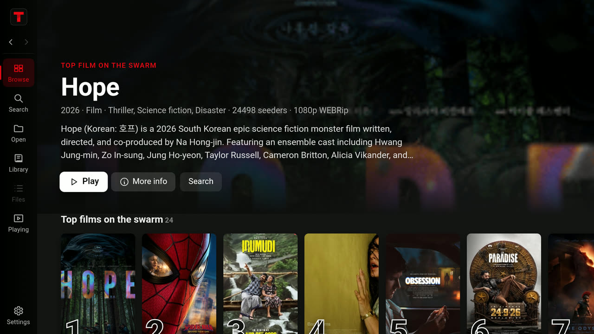
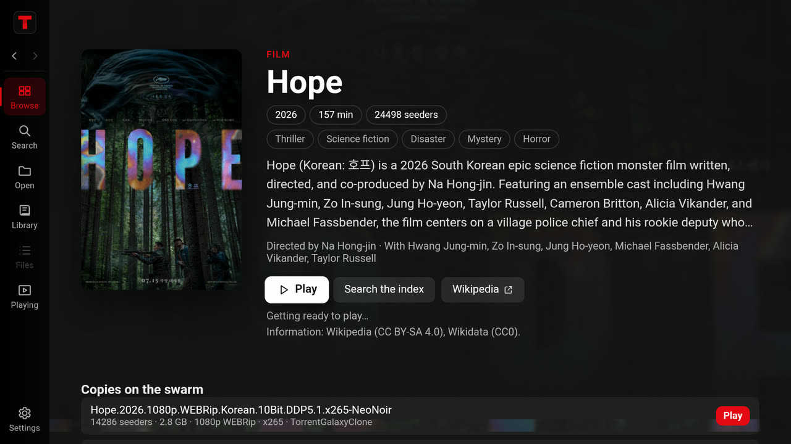
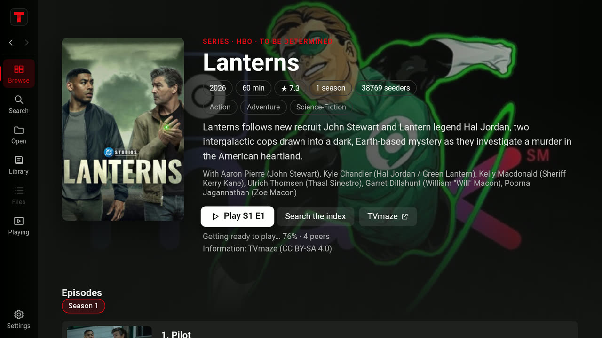
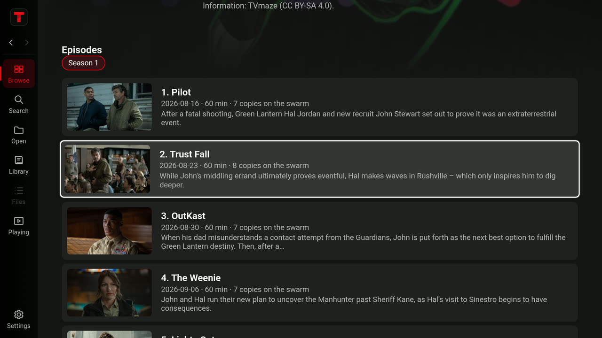

# Torflix

**Torflix for Android TV: browse what the swarm is watching, press Play on the remote, and it
streams.** A streaming-service front for torrents: rows of the most seeded films and series on
the public index, with posters and information, a page for every title with its seasons,
episodes and Resume, and the TV's own player. The whole torrent engine runs on the TV box
itself: no computer, no server, no account, no keys.

<p align="center">
  <a href="https://github.com/gary23w/torflix/releases/latest"></a>
  <br>
  <sub>One APK per processor family, plus the desktop app for Windows. <a href="#install-it-on-a-tv">How to install</a>.</sub>
</p>

<table>
  <tr>
    <td></td>
    <td></td>
  </tr>
  <tr>
    <td></td>
    <td></td>
  </tr>
</table>

## What it does on a TV

- **Browse.** A hero and rows of posters, the way a streaming service lays them out:
  *Continue watching*, *Top films on the swarm* and *Top series on the swarm* (the first ten
  ranked), *New films of this year*, *Series of this year*, *Films in 4K*, *Complete seasons*,
  *Streaming today* and *On TV tonight*. "Top" means what people are sharing right now: every
  torrent's release name is parsed, torrents of the same title are grouped, and titles are
  ranked by their seeders.
- **A page for every title.** Its backdrop and poster, overview, genres, running time, ratings,
  director and cast; for a series, its seasons and episodes, each marked with what the swarm has
  of it and how far it was watched; every copy on the swarm; and more like it. **Resume** (or the
  next episode) and **Play from start** when it was watched before.
- **Play starts fast.** While you read a title page, its first choice is got ready (metadata,
  peers, the start and end of the video, the resume point), and the player opens the moment
  Play is pressed. A copy that sends nothing for 20 seconds gives way to the next copy of the
  same film or episode.
- **The TV's own player** (Media3 ExoPlayer), which handles Matroska and HEVC on the TV's
  hardware decoder, with subtitles from the torrent. **Dolby Digital, Dolby Digital Plus, TrueHD
  and DTS sound** plays even on boxes that give apps no decoder for it: FFmpeg's audio decoders
  are built into the app.
- **Made for the remote.** The chosen card grows white-framed and its row slides to bring it to
  the front; each row and set of buttons is entered where it was left (the hero and a title page
  at Play); Up at the top shows the whole page from its top; every move answers within about a
  tenth of a second. OK presses, Back goes back, and on the first page Back asks once before
  leaving, since leaving stops the engine.
- **Search** dozens of public indexers at once, with one Best pick ranked for watching.
- **Updates itself** from this repository's releases (below).

## Install it on a TV

You need a TV or TV box with Android 7.0 or newer (Android TV, Google TV, or a plain Android
box). Download the APK for its processor family from the
[latest release](https://github.com/gary23w/torflix/releases/latest):

| File | For |
| --- | --- |
| `torflix-<version>-armeabi-v7a.apk` | most TV boxes and sticks (32-bit ARM; many 64-bit chips run 32-bit Android) |
| `torflix-<version>-arm64-v8a.apk` | TVs and boxes running 64-bit ARM Android |
| `torflix-<version>-x86_64.apk` | the Android TV emulator |

`adb shell getprop ro.product.cpu.abi` names the TV's processor family. An APK for the wrong
one does not install.

**On the TV itself**, with a downloader app from the TV's app store (for example *Downloader*):
open `github.com/gary23w/torflix/releases/latest`, pick the APK, and install it. Android first
asks to allow that app to install apps.

**From a computer**, with [adb](https://developer.android.com/tools/adb): turn on Developer
options on the TV (Settings → Device Preferences → About, press Build seven times), turn on USB
or network debugging, then:

```bash
adb connect <tv-address>:5555
```

```bash
adb install -r torflix-<version>-armeabi-v7a.apk
```

Torflix appears with the TV's apps. The APKs are signed by this project, not by Google Play, so
Play Protect may ask you to confirm an app from an unknown developer.

**Updates.** Each time it starts, Torflix asks this repository for its latest release. If that
release is newer and has an APK for the TV's processor, a screen shows the download filling a
bar (size, speed, percent), then hands the APK to Android to install. The download is checked
against the release's size and SHA-256, and Android only installs it over Torflix if it carries
the same package name and signing key. The first time, Torflix asks to be allowed to install
apps (Android 8 and later), and Android usually asks to confirm each update. Back puts the
update off until the next start. Android 10 and later don't let an app reopen itself after it
installs, so Torflix says it will close, and on the next start it says it was updated.

## On a computer

The same app runs on the desktop (Electron), with a mouse-and-keyboard player: keyboard
controls, a seek bar that shows what is downloaded, a live piece map (D), subtitles from the
torrent or a file, and the same Browse, title pages and search.

<p align="center">
  <a href="assets/demo/torflix-demo.mp4"></a>
  <br>
  <sub>The desktop app, recorded live and not sped up. <a href="assets/demo/torflix-demo.mp4">Full demo (MP4, 2:57)</a>.<br>
  <em>Sintel</em> and <em>Tears of Steel</em> © Blender Foundation, <a href="https://creativecommons.org/licenses/by/3.0/">CC BY 3.0</a>.</sub>
</p>

Each release has a Windows installer (`Torflix-Setup-<version>.exe`). It is not code-signed, so
Windows SmartScreen asks first: More info → Run anyway. On macOS and Linux, run it from source:

```bash
npm install
```

```bash
npm start
```

You need Node.js 22 or newer.

| Command              | What it does                                                                                   |
| -------------------- | ---------------------------------------------------------------------------------------------- |
| `npm test`           | Unit tests: release-name parsing, title grouping, ranking, subtitles, queue, audio tracks, piece priorities, resume data, Play rules, other copies, title data, cache limits. |
| `npm run smoke`      | Starts the real app, loads Browse, runs a search, streams and plays an open torrent, and writes screenshots to `smoke/`. Uses its own temporary data folder. |
| `npm run dist`       | Builds installers with electron-builder (NSIS on Windows, DMG on macOS, AppImage/deb on Linux). |
| `node tools/make-icon.mjs` | Redraws the app icon (PNG, ICO, ICNS) from code.                                         |

Pass `--dev` (or set `TORRENTPLAYER_DEV=1`) for the developer tools (F12) and engine logging.

On the desktop, Dolby and DTS sound needs [FFmpeg](https://ffmpeg.org): Torflix probes each
video's audio tracks, picks the one in your language, and plays it converted to AAC alongside
the video, in sync; the picture is untouched. Without FFmpeg the player says why there is no
sound. FFmpeg is never downloaded by Torflix: it is found on `PATH`, where winget links it, or in
a folder chosen in Settings → Advanced (`winget install Gyan.FFmpeg` on Windows,
`brew install ffmpeg` on macOS, your package manager on Linux).

## Everything it does

- **Browse** (the start page, Ctrl+B on the desktop). The rows above come from a few broad
  searches of the public index. Posters, overviews, ratings, genres and cast fill in from
  Wikipedia and Wikidata (films) and TVmaze (series). Rows are cached for 30 minutes and title
  information for a week (half a day for a series still airing).
- **Title pages.** A card (or a search result's Title button) opens the title's own page. As it
  opens, its first choice is got ready to play, so Play starts in about a second when the swarm
  is quick; leaving the page drops it, unplayed data and all (Settings → Playback).
- **Search** the public index at `search.emberglow.tech` (a JSON API over Jackett). Results
  stream in per indexer, merged and ranked by relevance and a watch score (seeders, resolution,
  source, HDR, playability, a fake-4K size check), with one Best pick and its reason. Rows show
  a poster looked up from the release name. Two switches in Settings → Search, both off by
  default, fetch more from the swarm: preloading the best pick, so Play starts at once and its
  row shows a frame of the video, and fetching details and pictures from the results on screen
  ("details ready", a picture from inside the torrent). Filters: resolution, plays-in-built-in-player,
  seeders, video/audio, indexer, sort, title. Rows hold still under the pointer; a per-indexer
  list shows who answered; recent searches are one click away; the box accepts magnet links.
- **Open** a magnet link, a link to a `.torrent` file, or a `.torrent` file (drop it on the
  window or pass it on the command line).
- **Player.** On the desktop: Space/K, ←/→ 5 s, J/L 10 s, ↑/↓ volume, F, M, C captions, D debug
  overlay with a live piece map, 0–9, `<` `>` speed; a status line (rates, peers, seconds
  buffered ahead, percent, ETA); subtitles drawn above the controls while they show; a
  now-playing view for audio. On a TV, the TV's own player shows the peers and speed while a
  video starts or buffers.
- **One video at a time.** The Playing tab holds the video playing and nothing else: playing
  another replaces it, so nothing downloads in the background for a list of videos. With "Download
  the whole video" on (Settings → Bandwidth and seeding), the rest of the one playing downloads
  too, so skipping ahead is instant.
- **Library** with resume positions; **Files** with previews and torrent details; **Settings**
  for playback, storage and cache limits, bandwidth and seeding, search, Browse, network and
  the debug overlay.

## How it streams

The player reads from a loopback server that serves the file as its pieces arrive. The pieces
right after the position the player asks for are fetched before anything else, then the rest
of the file; when you skip, the new position takes over. A Matroska (MKV) or MP4 file's start
and end are fetched together, since the player reads both before it shows a frame. Each
torrent's metadata and a map of the pieces already on disk are saved in Torflix's data folder,
so opening it again needs no peer for its details and does not re-check everything already
downloaded. A torrent can only start as fast as its swarm sends the first piece: a video already
on disk or got ready plays at once; a cold one takes as long as its peers do.

By default only the video being watched downloads, and it uploads to its peers only while it
plays (BitTorrent peers send to those who send back). When nothing plays a torrent any more, it
disconnects. A title page getting its first choice ready is on by default and uploads nothing
until it plays; downloading the whole video, preloading a search's best pick, fetching from
results, and sharing after watching are each a switch in Settings, off until turned on.

Seeder counts on the index can be stale, so a copy is judged by what arrives. If a torrent sends
nothing within 20 seconds of Play (no peer sends its details, or no data before the first
frame), the next copy of the same film or episode that Browse or a search found plays instead,
and a toast offers to go back. Up to three copies are tried; it can be turned off in Settings →
Playback.

## What it talks to

Torflix has no telemetry. Its traffic is:

- BitTorrent traffic for what you play, for the title page you are on (getting its first choice
  ready), and for what you preload, prefetch or keep sharing with those switches turned on.
- The public index, for your searches, the Browse rows (a few broad queries, cached), and a
  title page's copies.
- The Torflix metadata service (`torflix-meta.vercel.app`, the code in `meta/`), for posters
  and information about titles, with a title's kind, name and year as the only things sent. It
  asks Wikipedia, Wikidata and TVmaze, and Vercel's CDN keeps each answer for every user; it
  keeps nothing of its own (Vercel's platform keeps its usual request logs). With it off
  (Settings → Browse), or when it cannot be reached, Torflix asks those sources itself, paced.
  Every request names Torflix and its repository in its User-Agent.
- Poster images load from `static.tvmaze.com` and `*.wikimedia.org`; those two are the only
  hosts the window may load from besides itself and the loopback stream server. Information
  can be turned off in Settings → Browse.
- On a TV, this repository's latest release on GitHub, once per start, for updates.

FFmpeg, when used on the desktop, runs locally and reads only from the loopback stream server.

## Building the Android TV app

The same engine and pages run on Android TV. The app (`android/`) starts Node.js as a child
process with the backend (`src/android/backend.js`), which runs the desktop's services and serves
the pages and their commands to a full-screen WebView over a loopback bridge, behind a per-run
token. Videos play in a native Media3 ExoPlayer activity, opened the moment Play is pressed.
Peers are TCP only (no uTP or WebRTC).

Building it takes three steps. Node.js for Android is built once from the official source in
WSL (Ubuntu), with Node's own `android-configure`; it takes about an hour per processor family:

```bash
wsl -u root -- apt-get install -y python3 g++ g++-multilib make unzip curl xz-utils file
```

```bash
wsl -- bash tools/android/build-node.sh
```

FFmpeg's audio decoders are built the same way, a few minutes per processor family:

```bash
wsl -- bash tools/android/build-ffmpeg.sh
```

Then the backend and pages are bundled into the app's assets, and the APKs are built (JDK 17):

```bash
npm run android:build
```

```bash
cd android && ./gradlew assembleDebug
```

There is one APK per processor family in `android/app/build/outputs/apk/debug/`, installed as
above.

## Releases

A release holds both the APKs, named `torflix-<version>-<abi>.apk`, and the desktop installers,
under the tag `v<version>`. The APKs have to be on the release GitHub calls latest, since that is
the one every TV asks for. Raise the version in `package.json`, then build the APKs into
`dist/android/` and publish them (needs the GitHub CLI, `gh`):

```bash
npm run android:release -- --publish
```

Without `--publish` it only builds them. Then add the desktop installers to the same release.
Releases are signed with the same key as the test builds (`~/.android/debug.keystore` on the
machine that builds them): a TV takes an update only from the key its Torflix was installed
with, so keep that file. To try an update without publishing anything, build an older version
that reads a feed on the TV's own loopback, and serve that feed through `adb reverse`; the two
Gradle properties for this are explained in `android/app/build.gradle.kts`.

The APK carries FFmpeg's `ac3`, `eac3`, `dca`, `truehd` and `mlp` decoders, built without any of
FFmpeg's GPL or nonfree parts, so under the LGPL 2.1 or later, and Media3's FFmpeg extension
(Apache 2.0). `build-ffmpeg.sh` fetches the exact sources it builds (FFmpeg 6.0.1, Media3 1.11.1)
and checks them.

## The metadata service

`meta/` is a Vercel project (`torflix-meta`) that answers title information from the same code
the app runs (`src/shared/meta`): one address per title, however a release spells it, so its
CDN keeps one answer per title for every Torflix user.

| Address | Answer |
| --- | --- |
| `/v1/movie/<slug>[/<year>]` | a film: its Wikipedia article (overview, poster) and Wikidata facts |
| `/v1/tv/<slug>[/<year>]` | a series from TVmaze, by exact name: seasons, cast, artwork |
| `/v1/tvmaze/<id>/episodes` | a series' episodes |
| `/v1/wd/<Q-id>` | a film by its Wikidata item |

A slug is the title in lower case with punctuation as dashes (`dune-part-two`). Films are kept a
week, running series half a day, misses a day; a source that is down or busy is never cached.

```bash
node tools/meta.mjs --serve
```

```bash
node tools/meta.mjs --deploy
```

The first serves it on `127.0.0.1:8787` to try; the second copies the shared code into
`meta/lib` and deploys it with the Vercel CLI (signed in first).

## Not here

- The original's own streaming engine, its WireGuard/SOCKS5 modes and kill switch, a bundled
  FFmpeg on the desktop, and code-signed installers.

## Layout

```text
src/main/        the services behind the window (Electron main process on the desktop)
  main.js        window, tp:// scheme, menu, start-up and shutdown
  core.js        the services behind the window, started the same way on desktop and Android
  threadpool.js  imported first: a larger worker pool for disk reads and writes
  engine.js      WebTorrent facade: add, resolve links, select files, limits, remove
  resume.js      saved metadata and piece maps, so adding a torrent again is instant
  pieces.js      piece arithmetic, and the playhead focus that fetches the next pieces first
  stream-server.js  loopback HTTP range server with a per-run token
  streams.js     playback streams: open, stats, playback reports, subtitles, audio tracks
  media-tools.js optional FFmpeg: finding it, probing audio tracks, converting Dolby/DTS audio
  search.js      search service: event stream, merge, rank, cache, quiet searches
  browse.js      Browse rows: index queries, title grouping, enrichment
  titles.js      title pages: copies, what was watched, which copy plays an episode
  metadata.js    title information: the metadata service, else the sources; a disk cache
  preloader.js   getting a title page's first choice (or a search's best pick) ready
  prefetch.js    metadata prefetch and pictures from inside result torrents
  downloads.js   background downloads, seeding, snapshots
  library.js     playback history (JSON, atomic writes)
  settings.js    settings schema, validation, persistence
  cache.js       download-folder usage, Clear now, size and age limits
  commands.js    every command the renderer may call
  ipc.js         the commands over Electron IPC
  smoke.js       the end-to-end self-test
src/preload/preload.cjs  the contextBridge API (`window.tp`)
src/renderer/    the sandboxed UI: app.js (shell), views/ (title.js: title pages), lib/ (tv.js: the remote), styles.css
src/shared/      pure logic: release-name parsing, quality and ranking, other copies, file kinds, episodes, subtitles
src/shared/meta/ title information from Wikipedia, Wikidata and TVmaze (the app and the service share it)
meta/            the metadata service on Vercel
src/android/     the Android backend and its bridge, and the page's `window.tp` over it (tp-shim.js)
android/         the Android TV app: WebView window, Node process, TV player, updater
tools/make-icon.mjs  the icon generator
tools/meta.mjs   the metadata service: try it locally, deploy it
tools/android/   bundling the backend and pages, building Node.js and FFmpeg's audio decoders for Android, release APKs
test/            unit tests
```

The renderer runs sandboxed with context isolation, loads from the app's own `tp://` scheme
under a strict Content Security Policy, builds every node from text (torrent names and
overviews are never parsed as HTML), and reaches the main process only through the commands
in `commands.js`. Stream URLs carry a random per-run token.

## License

Torflix is under the MIT license or the Apache License 2.0, at your option
([LICENSE-MIT](LICENSE-MIT), [LICENSE-APACHE](LICENSE-APACHE)). The FFmpeg decoders inside the
APK are under the LGPL 2.1 or later, as above.
